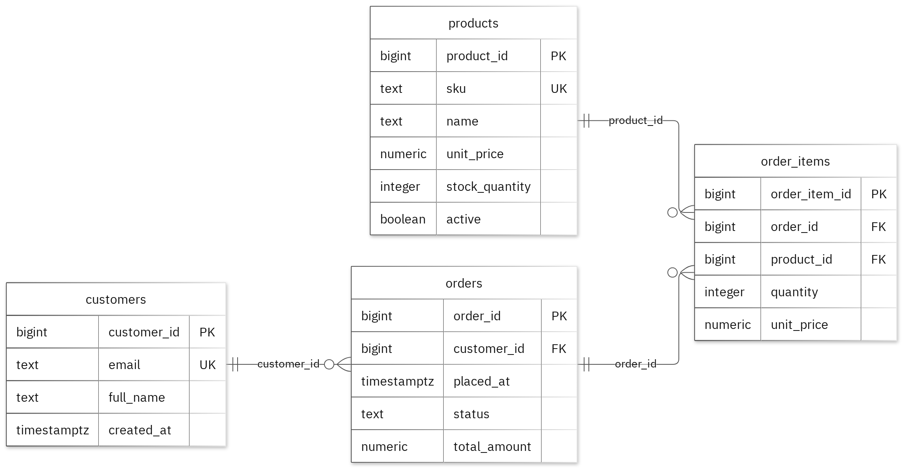

# MIT 8103: Advanced Database Systems

**Case Study: E-commerce Platform**  
**Student:** Deborah Alao  
**Student ID:** 1293

## Case Study

For this case study, I worked on an E-commerce Platform database. The idea was to design a database that could handle customers placing orders while allowing shop staff to check orders and monitor available stock.

I organised the database into four tables: `customers`, `products`, `orders`, and `order_items`. Each table has its own purpose, and together they support the main activities of the platform, such as viewing products and their available stock, placing orders with one or more items, and checking customers' order histories and total sales.

## Portfolio 1: Database Design and Modelling

I designed the database using four related tables, with primary keys to identify records and foreign keys to connect the tables properly. I also included constraints to enforce the business rules, especially the rule that available stock must never be negative.

For normalisation, I showed how the sample data can be organised into First Normal Form (1NF), Second Normal Form (2NF), and Third Normal Form (3NF). I also tested 13 deliberately invalid insert statements, and all of them were rejected without affecting the existing valid records.

*Figure 1: The database tables, their keys, and the relationships between them. PK means primary key, FK means foreign key, and UK means unique key.*

<!-- PAGE BREAK -->

## Portfolio 2: Query Processing and Optimisation

For this part, I ran three SQL queries using the sample records to check that the database returned the expected results. One of the joins returned three rows, including the record for `alex@example.test` with product code `MUG-001`.

I also compared query performance before and after adding an index. For this test, I used a separate set of 50,000 performance records. The median lookup time reduced from 2.349 ms to 0.276 ms after the index was added. Both tests returned the same records, and the execution plan showed that the new index was being used.

This exercise helped me see that getting the correct result is only part of the process. It is also important to understand how the database retrieves that result and how much work the query requires. The timing difference applies to the particular lookup and environment I tested.

## Portfolio 3: Transactions and Concurrency

I used a temporary counter on the products table to practise working with transactions and understand how multiple database sessions can affect the same record.

I tested `COMMIT`, `ROLLBACK`, and `READ COMMITTED` isolation. During the exercise, an uncommitted update was not visible to the other session, and rolling back the transaction restored the previous committed value.

I also tested what happens when two sessions try to increment the same counter. Without locking, both sessions read the same initial value, so the final counter was 2 instead of the expected 3. When I used `SELECT FOR UPDATE`, Session B had to wait for Session A to finish before proceeding, and the final counter was 3.

The counter was only used for this exercise. I kept the original business fields in the case study unchanged.

## Portfolio 4: NoSQL and Advanced Data Models

For the NoSQL exercise, I used MongoDB to represent the case study's order events. I inserted six sample event documents and ran four queries, all of which returned the expected results.

I also tested the validation rules by attempting to insert an invalid date type and a duplicate event ID. Both were rejected.

One thing I explored was how embedded snapshots can keep related information together within an event document. I also used a `details` field that can contain different information depending on the type of event.

The events used in this exercise are fictional. MongoDB was used to explore the NoSQL side of the case study, while PostgreSQL remains responsible for enforcing the relational database rules.

## Repository and Evidence

The SQL scripts, JavaScript files, explanations, query plans, result tables, and screenshots for the exercises are available in my GitHub repository:

https://github.com/dalao2026/Alao_Deborah_1293

<!-- PAGE BREAK -->

## Portfolio 5: Distributed and Cloud Database Exercise

For this exercise, I proposed a MongoDB replica set with three members located across separate failure zones. I discussed how primary elections work, why majority acknowledgement matters, how secondary replication lag can affect data access, and the trade-offs involved in sharding the `order_events` collection.

The main thing I took away from this exercise is that replication and backups serve different purposes. Replication can help a system remain available when a member fails, while backups are important for recovering data when necessary.

I also considered the fact that PostgreSQL would need its own availability and recovery plan. This portfolio was completed as a discussion-based exercise, so I did not deploy a live replica set or carry out an actual failover test.

## Individual Reflection

Working on this case study helped me understand why it is important to organise a database properly from the beginning. I kept `customers`, `products`, `orders`, and `order_items` in separate tables so that information could be maintained without unnecessarily repeating the same details across related records.

I also learnt the importance of enforcing business rules at the database level. For example, available stock should never be negative, and the relationships between records need to remain valid.

The transaction exercise was particularly useful because it showed me what can happen when two sessions try to update the same record at the same time. Both sessions can read the same value before either update is committed, which can lead to one of the increments being lost. Using row locking helps prevent this by making one session wait for the other to finish.

The query optimisation exercise also showed me that two queries or database setups can return the same result but require different amounts of work to do so. This is why checking the execution plan matters, rather than looking only at the final output.

Overall, the exercises gave me a more practical understanding of relational database design, query performance, transactions, concurrency, and NoSQL data modelling.

## AI-Use Declaration

I used GitHub Copilot and the portfolio generator to assist with preparing the database model, scripts, and explanations. The generator also ran the PostgreSQL and MongoDB exercises, checked the outputs, and captured the result images.

I remain responsible for reviewing the submitted work, checking the results, and being able to explain the design decisions and concepts demonstrated in the portfolio.

## References

- [PostgreSQL: Constraints](https://www.postgresql.org/docs/17/ddl-constraints.html)
- [PostgreSQL: EXPLAIN](https://www.postgresql.org/docs/17/using-explain.html)
- [PostgreSQL: Transaction Isolation](https://www.postgresql.org/docs/17/transaction-iso.html)
- [PostgreSQL: Explicit Locking](https://www.postgresql.org/docs/17/explicit-locking.html)
- [MongoDB: Data Modelling](https://www.mongodb.com/docs/manual/data-modeling/)
- [MongoDB: Replication](https://www.mongodb.com/docs/manual/replication/)
- [MongoDB: Sharding](https://www.mongodb.com/docs/manual/sharding/)
- [Mermaid: Entity Relationship Diagrams](https://mermaid.js.org/syntax/entityRelationshipDiagram.html)
